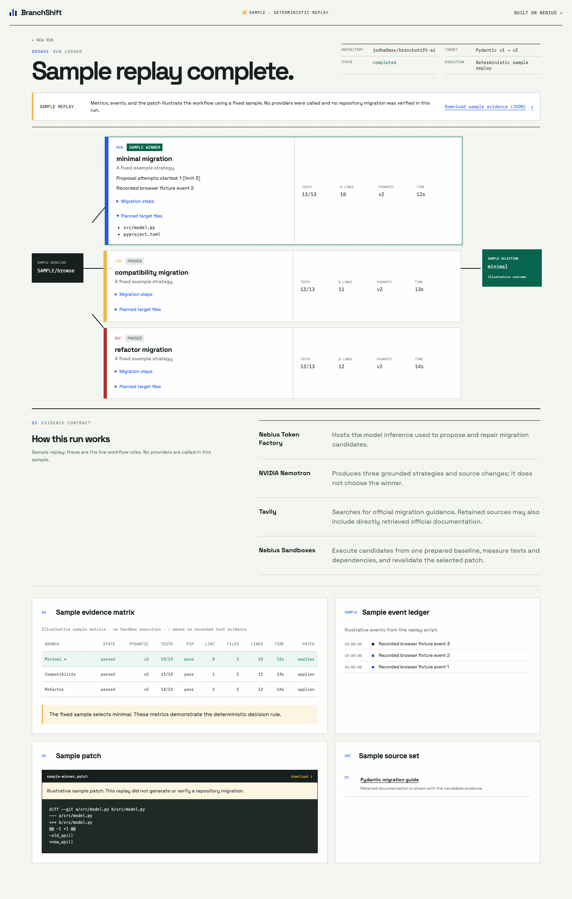

# BranchShift

**MIT licensed** · [License](LICENSE)

Bundled browser assets retain their
[third-party licenses](apps/web/public/third-party-notices.txt).
The earlier pinned runtime candidate is
[`v0.1.0-rc.1`](https://github.com/jsdhwfmax/branchshift-ai/tree/v0.1.0-rc.1);
later packaging changes are documented in the
[asset provenance record](docs/evidence/third-party-assets.md). The current
private hosted preview is verified separately below.

[](https://github.com/jsdhwfmax/branchshift-ai/actions/workflows/ci.yml)

BranchShift is an evidence-first dependency migration agent. It asks NVIDIA
Nemotron on Nebius Token Factory for three distinct migration strategies,
runs each from the same Token Factory Sandbox checkpoint, and selects the
candidate supported by deterministic tests, dependency checks, lint results,
and patch size. The candidate must pass a second execution from the clean
baseline before its patch becomes a verified result.

The current development revision brings saved runs and their outcomes to the
front of the interface. Optional explicit model-input examples compare baseline,
candidate and fresh-check behavior for maintainer review. Passing the original
tests is not a claim that every possible input behaves identically.

The live pipeline clones the public repository in a Nebius Sandbox, records
its commit and original tests, retrieves official migration guidance, and asks
an NVIDIA Nemotron model to edit exact source files. Three bounded repair
loops execute independently from the same baseline. Test files and test
configuration remain protected; checks run with the Pydantic 2 package installed.
Models may still use its v1 compatibility API: passing these checks does not
establish full native-v2 API adoption.

An explicitly labelled offline sample is also available. Sample metrics are
illustrative. Five controlled cases now have verified live patch-check evidence;
broader reliability remains under validation. A credential-protected
[hosted preview](https://branchshift.onrender.com) has completed one live
commissioning run; final judge capacity remains to be set.

## Current evaluation evidence

The [external `pydantic-yaml` comparison](evaluation/external-pydantic-yaml/README.md)
exposes a current limitation. Its original suite passed with 14 passes and one
existing xfail; the official `bump-pydantic` candidate produced eight import-time
collection errors. Across two declared development iterations, 15 real Nemotron
calls produced no patch that passed the generation prechecks, so AI candidate
tests did not run. Neither method demonstrated a working native-v2 migration
on this case. Raw failures, fixed source/environment fingerprints and the
US$0.756100 model-usage estimate are retained. The comparator used an independent
GitHub runner; this is not another Nebius Sandbox acceptance run or evidence
of an AI success-rate advantage.

A separate [Codex-assisted manual reference](evaluation/manual-native-control-20261013/README.md)
now passes that original suite on native Pydantic 2.12.5, including a fresh-checkout
repeat, using 14 edits and 210 new lines within the existing limits. This establishes
feasibility on the inspected case; it does not change the 15-request autonomous
result or demonstrate general reliability. No additional evaluated model calls were made.

The [hosted acceptance record](docs/evidence/render-hosted-20261013/README.md)
documents a real Safari-started migration on Render at deployment commit
`2480ed9`: two passing candidates, a verified winner and clean-baseline retest,
working downloads and refresh, event replay, persistent-disk replacement
retention and passing CI. This is a private commissioning preview with a
one-run daily allowance at the time of acceptance, not the final judge allowance.

The [earlier runtime release verification](docs/evidence/runtime-release-63cf7fd/README.md)
records a real UI-started migration at `63cf7fd`, its downloadable JSON/Markdown
reports and patch, desktop/mobile refresh checks, passing CI and the published
container digest. It remains separate from the later hosted acceptance.

The [predeclared three-round evaluation](evaluation/series-20260910/README.md)
completed **15/15 live runs passing the recorded checks**: validators, configuration,
serialization, parsing and compatibility, each attempted three times at frozen
source/baseline `92c733a`. Every winner preserved the original tests, ran under
Pydantic 2 and passed clean-baseline revalidation. All 45 candidate outcomes
remain visible, including seven failed candidates.

A [retrospective candidate comparison](evaluation/series-20260910/README.md)
finds a smaller selected patch than the passing refactor alternative in 11 of
those 15 runs, equal size in three, and a larger patch with fewer lint findings
in one. The refactor branch itself passed in all 15, so this evidence does not
show a success-rate advantage over a standalone refactor agent. No standalone
or matched-budget comparison has been performed.

Median ledger duration was **53.022 seconds** and nearest-rank p95
**114.892 seconds**. The collector observed 79 model requests, 275,634 input and
126,231 output tokens, with complete returned-usage coverage. The corresponding
inference estimate is **USD 0.654327**, excluding taxes and other services;
176 returned Sandbox SDK calls are recorded separately from unknown billing.
These five small authored fixtures do not establish general production
migration reliability. Original records, exact patches, fingerprints and all
planned slots are retained in the linked cohort.

The [earlier development record](evaluation/results.md) remains unchanged:
**16 attempts, 9 failures and 7 qualified successes** across changing code/model
settings. It is separate from the frozen series above. See the
[collection and interpretation procedure](docs/evaluation.md).

## Architecture

```text
React control room -> FastAPI + SQLite event ledger
                              |
                 Tavily + Nemotron + Contree
                              |
          baseline -> three branches -> verified winner
```

## Local setup

Tested development environment: Node.js 24, pnpm 11.19, and Python 3.13.

```bash
cp .env.example .env
make install
make check
```

The browser suite serves production assets with local HTTP test data. It checks
desktop/mobile flows, real EventSource reconnects, downloads and selected
accessibility rules without calling live providers:

```bash
pnpm --dir apps/web exec playwright install chromium
pnpm --dir apps/web exec playwright test
```

Start the API and web app in separate terminals:

```bash
make api-dev
make web-dev
```

Open `http://localhost:5173`. The default `BRANCHSHIFT_MODE=mock` runs a
deterministic replay and never calls the network.

The public source repository is
[jsdhwfmax/branchshift-ai](https://github.com/jsdhwfmax/branchshift-ai), and the
controlled Pydantic v1 migration target lives under `fixtures/pydantic-v1-app`.

For live execution, set `BRANCHSHIFT_MODE=live`, `NEBIUS_API_KEY`,
`NEBIUS_PROJECT_ID`, and `TAVILY_API_KEY` in `.env`. Sandbox Beta access must be
enabled for the same Token Factory project. `NEMOTRON_MODEL` selects the exact
NVIDIA model; the run records the model used. The verified configuration uses
`nvidia/Nemotron-3-Ultra-550b-a55b` with `NEMOTRON_ENABLE_THINKING=true`.
Credentials stay in the API.

You can retain a complete live-run summary and any winning patch without
starting the web server:

```bash
.venv/bin/python -m app.cli.live_run --output ./local-evidence
```

For a Python project inside a public monorepo, supply `--project-path` or the
optional **Project directory** field in the live form. Empty input uses the
controlled example directory for this repository and the root for other
repositories. The project must have `pyproject.toml`, installable test
dependencies, and a passing Pydantic v1 baseline.

Use an optional full lowercase commit SHA to repeat a historical baseline,
and choose the project's declared extras when it does not provide `[test]`:

```bash
python -m app.cli.live_run --repo-url https://github.com/owner/repo \
  --baseline-ref FULL_40_CHARACTER_COMMIT_SHA --test-extras pyyaml,semver \
  --output ./local-evidence/experiment
```

This command is a live, credit-consuming execution; the placeholder SHA must be
replaced by an actual commit. The selected commit is verified before installing
the project. Pytest and Ruff are installed as execution tools. Existing skipped
or expected-failure tests are recorded separately. Each original passing test
must still pass: new skips, missing or renamed tests cannot masquerade as
passing patch checks. The API accepts the same `baseline_ref` and `test_extras`
fields, and the live form exposes them under advanced options.

Optional [behavior review examples](docs/behavior-review.md) freeze a small set
of model inputs before any edit. They run in separate Sandbox child states and
report acceptance and JSON-output differences for each candidate and its fresh
validation. They do not change the test-based winner or prove full equivalence.
Unknown or unsupported checks stay visible; existing historical records do not
gain invented review results. This feature is covered by local tests; new live
external-project validation remains pending.

A [local replay of the retained winning patch](docs/evidence/local-behavior-review-20261013/README.md)
found why this matters: a numeric name accepted by the original model was
rejected after migration, despite all 13 original tests passing. The replay's
versions and scope are documented separately from the unchanged cloud record.

The UI exports JSON evidence for successful and failed runs. A deterministic
Markdown report is available at `/api/runs/{id}/report?format=markdown`; the CLI
also writes `<id>.md` beside the original JSON and patch. It explains the stored
selection and revalidation, includes failed candidates, and labels missing
usage as unknown. It does not ask a model to invent an explanation. Each record
retains partial branch results, the original test digest, model token counts,
source/config fingerprints, and the final clean-baseline check when available.
Provider token counts are usage evidence, not a total invoice.

Use one API worker per SQLite database. On restart, interrupted runs become
cancelled with their evidence retained. Do not run a separate CLI worker
against an active API database. The CLI output directory provides its own
database by default.

## Safety boundary

- Only public HTTPS GitHub repository URLs are accepted.
- Untrusted repository code is designed to execute only inside Contree.
- Model output never selects the winner; stored test and patch metrics do.
- Secrets are redacted before provider output reaches the event ledger.
- Generated diffs are rejected if they escape the repository, touch undeclared
  files or Git metadata, contain binary data, or exceed configured limits.
- Live mode bounds runtime, source/output size, retries, and concurrency.
- Before dependency installation, a trusted Sandbox check rejects tracked
  checkouts above `MAX_REPOSITORY_BYTES` (50 MiB by default), including files
  outside the chosen project directory. This is a post-checkout acceptance
  gate, not a clone-transfer or complete disk-usage cap.
- HTTP run creation also enforces persistent global and per-client attempt
  quotas, unfinished-run limits and an 8 KiB actual-body cap. Existing evidence
  stays readable after a quota is exhausted. See the deployment runbook for
  proxy configuration and allowance semantics.

[Controlled probes](docs/evidence/security-boundaries.md) verified selected
host-canary boundaries and provider-reported timeouts/output truncation. Public
network egress is allowed. These observations do not establish general
prompt-injection immunity or exhaustive Sandbox isolation.
[Cost and latency evidence](docs/evidence/cost-and-latency.md) separates
response-token estimates, observed SDK calls and unknown billed charges.

See [container deployment](deploy/nebius-endpoint.md) for the prepared
same-origin Python/UI image and persistence requirements. At commit `92c733a`,
[CI](https://github.com/jsdhwfmax/branchshift-ai/actions/runs/34443169993) and
[image build, smoke and publication](https://github.com/jsdhwfmax/branchshift-ai/actions/runs/34443329138)
passed. The published Linux `amd64` image manifest is anonymously accessible.
The later [private Render preview](https://branchshift.onrender.com) has passed
the bounded [hosted acceptance checks](docs/evidence/render-hosted-20261013/README.md),
including disk retention across one replacement instance. Final judge access
capacity remains pending.

The [Render configuration](render.yaml) prepares one Docker service with a
1 GB persistent disk and explicit Ultra/thinking settings matching the live
evaluation. It starts with new runs closed (`HTTP_DAILY_RUN_LIMIT=0`) until
billing, mounted-disk writes and provider access have been verified. Attempt
quotas are not dollar spending caps. Hosted commissioning temporarily allowed
one daily run, which completed successfully. Set the final private judge
allowance before submission; this temporary allowance does not establish
ongoing evaluation capacity.

For private judge access, set `BRANCHSHIFT_REQUIRE_AUTH=true` and both
`BRANCHSHIFT_AUTH_USERNAME` and `BRANCHSHIFT_AUTH_PASSWORD` in backend secrets.
Use a dedicated randomly generated password of at least 32 characters (at
least 12 distinct characters), and serve the site over HTTPS. Missing or
invalid credentials fail startup. Only exact `GET /api` is public for health
checks; pages, evidence, downloads and API execution require authentication.
Authenticated browser writes must come from the same origin. The proxy must
preserve the public Host header; untrusted forwarding headers are ignored.
Supply the judge credentials privately with the submission, never in source
or a public URL. Both credentials omitted and `BRANCHSHIFT_REQUIRE_AUTH=false`
preserves unauthenticated local development.

## Hackathon technology

- **NVIDIA Nemotron on Nebius Token Factory** proposes migration plans and code edits.
- **Token Factory Sandboxes / Contree** branch reproducible filesystem states.
- **Tavily** retrieves allowlisted official migration documentation.
- **FastAPI + React** expose a judge-friendly live audit trail.

See `docs/superpowers/plans/2026-08-31-branchshift-implementation.md` for the
execution-ready build plan.

## Screenshot

<details>
<summary>Desktop sample replay — expand screenshot</summary>



**SAMPLE REPLAY**: “Metrics, events, and the patch illustrate the workflow using
a fixed sample. No providers were called and no repository migration was
verified in this run.”

[Browser validation and original desktop/mobile screenshots](docs/evidence/ui-browser.md)

</details>
