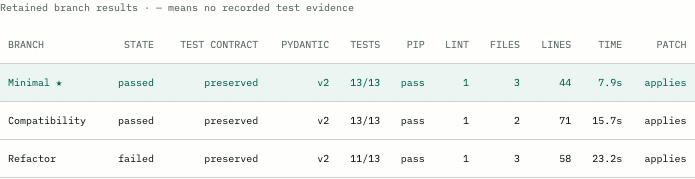

# Verified runtime release: 63cf7fd

Verified 10 September 2026 at source commit
[`63cf7fdb4c62e119facb87fe108e9c278960a5c1`](https://github.com/jsdhwfmax/branchshift-ai/commit/63cf7fdb4c62e119facb87fe108e9c278960a5c1).
This release adds recorded proposal progress, a pre-install tracked-checkout
size gate, deterministic Markdown reports and tested desktop/mobile flows.
The earlier [15-run cohort](../../../evaluation/series-20260910/README.md)
remains frozen at `92c733a`; the following is one later release verification.

## Real execution and usable exports

Run **`3ddea183879b`** was started once with **Split run** in the production UI
served at localhost. Both the orchestrator revision and cloned baseline were
`63cf7fd`. The browser showed preparing, planning, branch progress
and the final verified result. All three candidates retained the original
13-test contract and used Pydantic 2.

| Candidate | Result | Tests | Lint findings | Changed lines | Proposals started |
| --- | --- | --- | --- | --- | --- |
| Minimal | Winner | 13/13 | 1 | 44 | 1 |
| Compatibility | Passed | 13/13 | 1 | 71 | 2 |
| Refactor | Failed | 11/13 | 1 | 58 | 3 |

Minimal won after the lint tie because it changed fewer lines. Its exact patch
then passed clean-baseline revalidation on a separate checkpoint. The failed
refactor and all six proposal-start events are retained. Proposal counts mean
started proposals, not completed executions.



Read the [JSON evidence](live-run/3ddea183879b-report.json),
[Markdown report](live-run/3ddea183879b.md),
[winning patch](live-run/3ddea183879b.patch), or
[verification receipt](live-run/verification-receipt.json).
The patch is 3,242 bytes, SHA-256
`d3bf63ae2cd146b4db54564aa0dc4b20c3931e1dbbba63954e3fcc62f4a5b009`.
It matches the stored winner and clean revalidation byte for byte.
Repeated JSON and Markdown exports were identical; Markdown matched the
deterministic renderer. Response headers and original repeated exports remain
in `live-run/`.

Source-content digest `b10f14ba54cb60d5f1c858eb6928d4957255409f4e689d21b187e8d83fe07c1b`
and nonsecret configuration digest
`99c4a77f36522aaf6cc6830ab6f0f40f45ab95066077dda61cf4ad75a81a7b8e`
matched independent local recomputation. The stored dirty flag remains true:
untracked submission/video drafts were present. This is not a clean-worktree
claim. The new repository gate was configured at 50 MiB; its
[documented scope](../repository-size-gate.md) remains a post-clone acceptance
check, not a transfer, memory or total-disk limit.

An isolated Chromium browser subsequently read the same real result, downloaded
JSON and patch through the actual links and compared their bytes. Desktop
1440-pixel and mobile 393-pixel refreshes retained the result, with no page
JavaScript errors or horizontal page overflow in those checks. See the
[browser receipt](browser-live-verification.json). That verification issued no
run-creation requests. The earlier [four CI browser checks](../ui-browser.md)
use local test responses and have a separate purpose.

## Published source and image

- [CI run 34445971465](https://github.com/jsdhwfmax/branchshift-ai/actions/runs/34445971465):
  all 16 steps passed, including 324 API, 13 fixture, 29 component and four
  Playwright checks, Ruff, mypy, frontend type checks and production build.
  [Receipt](ci-63cf7fd.json).
- [Image run 34446125409](https://github.com/jsdhwfmax/branchshift-ai/actions/runs/34446125409):
  Linux/amd64 build, dependency imports, nonroot UID 10001, same-origin mock
  execution and retained ledger after container replacement passed. The GHCR
  publish step completed. [Receipt](image-63cf7fd.json).
- [Anonymous source reads](publication-63cf7fd.json) matched all 91 changed
  non-image files, including the 34 original cohort exports. Three PNGs were
  explicitly outside that HTTP byte check.
- [Anonymous registry reads](registry-anonymous-63cf7fd.json) matched the
  2,204-byte manifest and its digest. The small image configuration confirms
  Linux/amd64, user `10001:10001` and the exact revision label.

Published image:

```text
ghcr.io/jsdhwfmax/branchshift-ai:63cf7fdb4c62e119facb87fe108e9c278960a5c1
ghcr.io/jsdhwfmax/branchshift-ai@sha256:e1c84566cbe08d4ae5548288dea59cab78ea00dc8f596d4d34ca98c74f3ba9ac
```

The container smoke run used mock mode and runner-local bind storage. The
real provider run used the local Python runtime and production web assets.
Anonymous registry verification read the manifest and small configuration;
it did not download all image layers. Public Cloud hosting, Cloud persistence,
live execution inside that hosted image and judge access remain unverified.

## Retained artifacts and remaining delivery

[Artifact manifest](artifact-manifest.json) records each copied artifact's
size and hash. Original exported response bytes and screenshots are unchanged.
Only the verification receipt's private absolute file paths were replaced with
relative filenames, with its original receipt hash retained.
The source whitespace check excludes immutable `live-run/` exports: blank
unified-diff context lines contain a literal space, including in the exported
Markdown report. Those original bytes are preserved and the patch parses.

The [progress screenshot](live-3ddea183879b-progress.jpg) was captured while
the real run was branching. The [completed screenshot](live-3ddea183879b-completed-cua.jpg)
was captured after refreshing the completed result. The other desktop/mobile
images show the same saved real run, not a sample or a continuous recording.

The [deployment runbook](../../../deploy/nebius-endpoint.md) still requires
Cloud account access, actual resource and budget selection, durable storage
checks and public acceptance. Final video publication, the release tag and an
accepted Devpost submission also remain open. These artifacts establish a
verified runtime release; they do not establish a completed competition entry.
